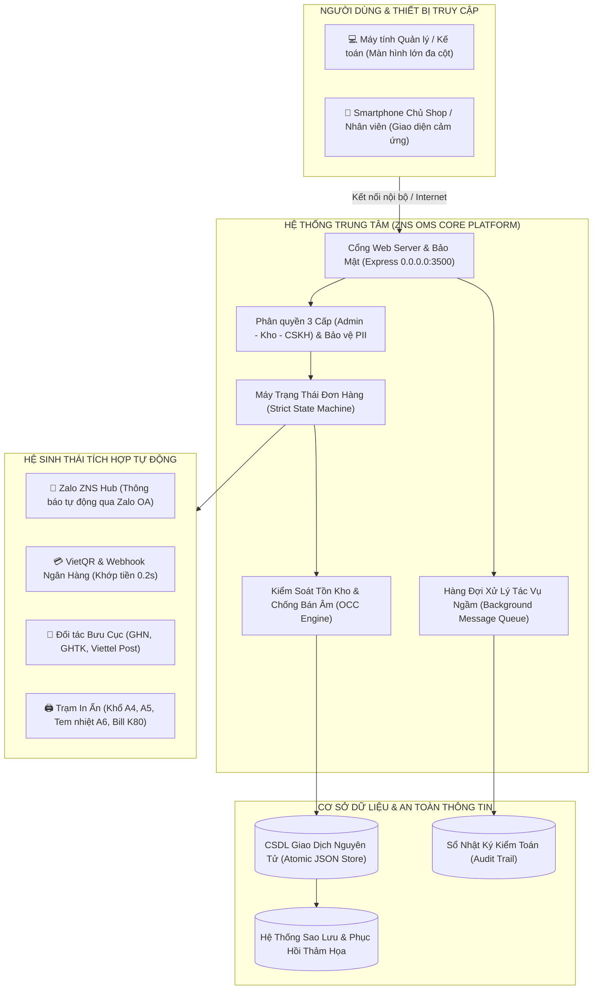
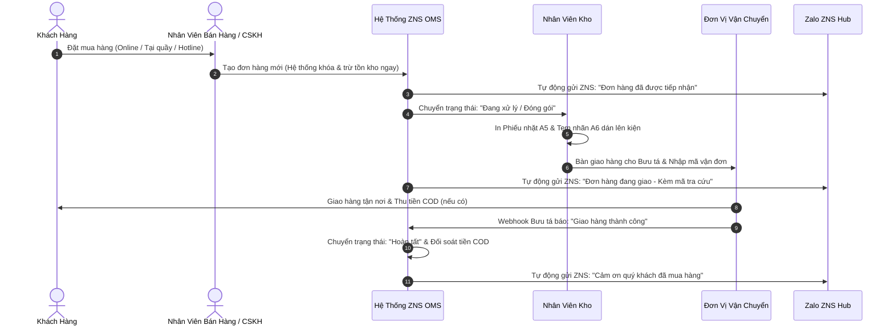

# HỒ SƠ KIẾN TRÚC & GIẢI PHÁP HỆ THỐNG QUẢN LÝ BÁN HÀNG VÀ CHĂM SÓC KHÁCH HÀNG ZNS
### Hệ Thống Quản Trị Đơn Hàng Doanh Nghiệp (ZNS OMS Enterprise Platform)

> **Tài liệu Bàn giao & Giới thiệu Giải pháp Dành cho Khách hàng / Đối tác**  
> *Đơn vị phát triển: Đội ngũ Kỹ thuật Hệ thống OMS Pro*  
> *Phiên bản giải pháp: 2.5 Enterprise Commercial Edition*

---

## 📌 TÓM TẮT DÀNH CHO LÃNH ĐẠO (EXECUTIVE SUMMARY)

Hệ thống **ZNS Order Master Pro (OMS Pro)** là nền tảng quản trị bán hàng và vận hành đơn hàng đa kênh thế hệ mới, được thiết kế chuyên biệt cho các doanh nghiệp bán lẻ, chuỗi cửa hàng và đơn vị thương mại điện tử. 

Khác biệt với các website bán hàng thông thường, **ZNS OMS Pro** giải quyết triệt để 4 bài toán sống còn trong kinh doanh:
1. **Chống thất thoát hàng hóa & Chống bán âm kho (Overselling):** Ứng dụng công nghệ khóa giao dịch nguyên tử (ACID Transactions & Optimistic Locking), đảm bảo tồn kho thực tế và sổ sách luôn khớp 100%.
2. **Tự động hóa chăm sóc khách hàng qua Zalo ZNS:** Tự động gửi thông báo thương hiệu Zalo OA chính chủ (Zalo Notification Service) khi tạo đơn, giao hàng và hoàn tất với chi phí rẻ hơn 60% so với SMS Brandname truyền thống.
3. **Đối soát dòng tiền tự động với VietQR Webhook:** Khách quét mã QR chuyển khoản, hệ thống tự động nhận diện và đổi trạng thái "Đã thanh toán" trong 0.2 giây mà không cần nhân viên kế toán ngồi kiểm tra sao kê thủ công.
4. **Vận hành linh hoạt trên cả Máy tính và Điện thoại:** Giao diện tối ưu đa nền tảng, lãnh đạo và nhân viên có thể theo dõi doanh thu, chốt đơn mọi lúc mọi nơi ngay trên Smartphone.

---

## 🏛️ 1. SƠ ĐỒ KIẾN TRÚC TỔNG THỂ HỆ THỐNG



---

## 💎 2. CÁC TÍNH NĂNG VƯỢT TRỘI DÀNH CHO KHÁCH HÀNG

### 1. Bàn Làm Việc Thông Minh (Executive Dashboard)
* Báo cáo doanh thu thực thu, tiền hàng đang lưu thông và tiền COD shipper đang giữ theo thời gian thực.
* Biểu đồ xu hướng doanh thu 7 ngày và biểu đồ tròn phân tích tỷ lệ trạng thái đơn hàng.
* Cảnh báo sản phẩm sắp hết hàng (Low stock alert) để kịp thời nhập thêm.

### 2. Quản Lý Đơn Hàng & Vận Chuyển Toàn Trình
* Bộ lọc đa chiều: Lọc theo trạng thái giao nhận, trạng thái thanh toán, kênh bán hàng.
* Tìm kiếm tức thì không cần tải lại trang theo mã đơn `DH-...`, tên khách, số điện thoại, mã vận đơn.
* Tự động tính toán chi phí: Tiền hàng, phí vận chuyển bưu cục, voucher giảm giá và tổng thu COD.

### 3. CRM Khách Hàng Thân Thiết & Phân Hạng Thành Viên VIP
* Tự động lưu trữ lịch sử mua sắm và tích lũy doanh số của từng khách hàng.
* Phân loại hạng thành viên tự động: **Tiêu chuẩn $\rightarrow$ Bạc $\rightarrow$ Vàng $\rightarrow$ Bạch kim $\rightarrow$ Kim cương** để áp dụng chính sách chiết khấu chăm sóc đặc biệt.

### 4. Tự Động Hóa Thông Báo Zalo ZNS
* Tích hợp trực tiếp dịch vụ Zalo Notification Service của Zalo OA.
* Mẫu tin nhắn gửi chuẩn quy định của Zalo, hiển thị logo và tên thương hiệu của doanh nghiệp.
* Cung cấp khung mô phỏng Smartphone trực tiếp trên web giúp quản lý xem trước nội dung tin nhắn gửi khách.

### 5. Cổng Thanh Toán VietQR Tự Động Khớp Tiền
* Tự động tạo mã QR động theo chuẩn Napas 247 có sẵn số tiền và nội dung chuyển khoản mã đơn.
* Webhook ngân hàng tự động nghe biến động số dư, đổi trạng thái đơn sang **"Đã thanh toán"** và gửi tin cảm ơn khách ngay lập tức mà không cần xác nhận thủ công.

### 6. In Ấn Đa Khổ Tiêu Chuẩn Doanh Nghiệp
Hệ thống tích hợp sẵn 4 biểu mẫu in chuyên dụng, kết nối trực tiếp với máy in mà không cần cài phần mềm phụ:
* **Khổ A4:** Phiếu xuất kho kiêm giao hàng chuẩn doanh nghiệp kèm mã vạch Code128.
* **Khổ A6 (100x150mm):** Tem nhãn nhiệt dán bọc hàng chuyên dụng cho máy in bưu cục (GHN/GHTK/Viettel Post).
* **Khổ A5:** Phiếu nhặt hàng kho (Packing Slip) có bảng danh mục kiểm đếm cho nhân viên kho.
* **Khổ K80:** Hóa đơn nhiệt cuộn 80mm cho máy in bill bán hàng POS tại quầy.

---

## 🔄 3. QUY TRÌNH LUỒNG ĐƠN HÀNG CHUẨN (ORDER WORKFLOW)



---

## 🛡️ 4. BẢO MẬT DOANH NGHIỆP & PHÂN QUYỀN (RBAC)

Để ngăn chặn nguy cơ rò rỉ danh sách khách hàng sang tay đối thủ hoặc nhân viên gian lận giá, hệ thống áp dụng cơ chế phân quyền 3 tầng nghiêm ngặt:

| Tiêu Chí Nghiệp Vụ | 👑 Ban Giám Đốc / Chủ Shop | 📦 Bộ Phận Kho Vận | 💼 Nhân Viên CSKH / Sales |
| :--- | :---: | :---: | :---: |
| **Báo cáo Doanh thu & Lãi lỗ** | ✅ Xem toàn bộ | ❌ **Ẩn hoàn toàn** | ⚠️ Chỉ xem doanh số bán |
| **Giá Vốn Nhập Hàng (Cost)** | ✅ Toàn quyền xem | ❌ **Ẩn hoàn toàn** | ❌ Ẩn giá vốn |
| **Tạo / Sửa Đơn Hàng** | ✅ Toàn quyền | ❌ Không được tạo | ✅ Toàn quyền tạo đơn |
| **Bảo Vệ SĐT & Địa Chỉ Khách** | ✅ Hiển thị đầy đủ | 🔒 **Che sao (`0982***051`)** | ✅ Hiển thị để tư vấn |
| **Mở Khóa Dữ Liệu Khách (Unmask)**| ✅ Tự do | ⚠️ **Bắt buộc nhập lý do & ghi Audit** | ✅ Tự do |
| **Xóa Đơn Hàng Khỏi Hệ Thống** | ✅ Toàn quyền | ❌ Bị chặn | ❌ Bị chặn |
| **Sao Lưu & Khôi Phục CSDL** | ✅ Toàn quyền | ❌ Bị chặn | ❌ Bị chặn |

---

## 📱 5. KHẢ NĂNG TƯƠNG THÍCH ĐA NỀN TẢNG (PC & MOBILE)

Khách hàng không cần phải đầu tư thiết bị đắt tiền, hệ thống hoạt động hoàn hảo trên mọi thiết bị hiện có của cửa hàng:

```text
       ┌──────────────────────────────┐
       │   💻 LAPTOP / PC VĂN PHÒNG   │
       │   - Giao diện Sidebar rộng   │
       │   - Quản trị báo cáo, in ấn  │
       │   - Đối soát ngân hàng       │
       └──────────────┬───────────────┘
                      │ Cùng truy cập vào Hệ thống OMS
                      │ (Đồng bộ thời gian thực 100%)
       ┌──────────────┴───────────────┐
       │   📱 SMARTPHONE DI ĐỘNG      │
       │   - Menu trượt cảm ứng nhẹ   │
       │   - Thanh phím tắt dưới đáy  │
       │   - Nút (+) Tạo đơn 1 chạm   │
       └──────────────────────────────┘
```

* **Trên Máy tính văn phòng:** Truy cập trình duyệt qua đường dẫn nội bộ hoặc tên miền riêng.
* **Trên Điện thoại nhân viên/chủ shop:** Chỉ cần cùng bắt sóng Wi-Fi của cửa hàng là vào được ngay, không cần tải ứng dụng phức tạp từ App Store/Google Play.

---

## ⚙️ 6. ĐIỀU KIỆN KỸ THUẬT & PHƯƠNG ÁN TRIỂN KHAI

Hệ thống được lập trình tối ưu hóa với kiến trúc phi phụ thuộc nặng nề:
* **Môi trường chạy:** Node.js (phiên bản 18.0 trở lên).
* **Cơ sở dữ liệu:** File-based Atomic JSON Engine (không đòi hỏi cài đặt SQL Server hay Oracle cồng kềnh, sao lưu và di chuyển dễ dàng chỉ bằng 1 file thư mục).
* **Yêu cầu phần cứng tối thiểu:** 
  * RAM: Tối thiểu 2GB (Khuyến nghị 4GB).
  * Ổ cứng: Trống tối thiểu 1GB.
  * Hệ điều hành: Windows 10/11, Windows Server, Ubuntu Linux hoặc macOS.

### 2 Phương Án Triển Khai Linh Hoạt:
1. **Phương Án 1: Triển khai Cục bộ (On-Premise / Mạng Nội Bộ):**
   * Chạy trực tiếp trên máy tính thu ngân / máy tính chủ của shop.
   * Tất cả điện thoại và máy tính trong quán/cửa hàng kết nối qua Wi-Fi nội bộ.
   * **Ưu điểm:** Chi phí máy chủ hàng tháng bằng 0 đ, dữ liệu tuyệt đối nằm tại cửa hàng.
2. **Phương Án 2: Triển khai Máy Chủ Đám Mây (Cloud Server / VPS):**
   * Đặt trên Cloud (Viettel IDC, FPT Cloud, DigitalOcean, AWS).
   * Nhân viên và chủ shop có thể truy cập từ bất kỳ đâu qua mạng 4G/5G/Internet.
   * **Ưu điểm:** Quản lý chuỗi nhiều chi nhánh tập trung, giám sát từ xa mọi lúc mọi nơi.

---

## 📅 7. QUY TRÌNH BÀN GIAO & VẬN HÀNH DỰ ÁN

```text
BƯỚC 1: TIẾP NHẬN & CẤU HÌNH (1 ngày)
├── Cài đặt hệ thống trên máy tính của quý khách
└── Cấu hình thông tin Shop, Ngân hàng VietQR và Zalo ZNS

BƯỚC 2: NHẬP DỮ LIỆU BAN ĐẦU (1 ngày)
├── Nhập danh mục sản phẩm, bảng giá và số lượng tồn kho ban đầu (qua Excel)
└── Phân quyền tài khoản cho các bộ phận (Chủ shop, Kho, CSKH)

BƯỚC 3: KIỂM THỬ & ĐÀO TẠO (1 - 2 ngày)
├── Đào tạo nhân viên thao tác: Tạo đơn, Đổi trạng thái, In hóa đơn
└── Kiểm tra giả lập quét mã shipper và chuyển khoản ngân hàng

BƯỚC 4: BÀN GIAO & VẬN HÀNH CHÍNH THỨC
├── Bàn giao trọn gói mã nguồn và quyền làm chủ hệ thống
└── Kích hoạt chế độ tự động sao lưu an toàn hàng ngày
```

---

## 📞 THÔNG TIN HỖ TRỢ KỸ THUẬT & LIÊN HỆ

Mọi yêu cầu tùy chỉnh thêm tính năng theo đặc thù của doanh nghiệp quý khách, vui lòng liên hệ:
* **Hệ thống Quản lý Bán hàng:** ZNS Order Master Pro
* **Kho lưu trữ mã nguồn chính thức:** [https://github.com/nguyenkhanh3122005/quanlybanhang](https://github.com/nguyenkhanh3122005/quanlybanhang)
* **Tài liệu Kỹ thuật Đi kèm:** `TONG-QUAN-KIEN-TRUC-HE-THONG-ZNS-OMS.md`

*(Tài liệu này được biên soạn độc lập phục vụ việc giới thiệu giải pháp, đối soát kỹ thuật và ký kết hợp đồng triển khai với khách hàng).*
