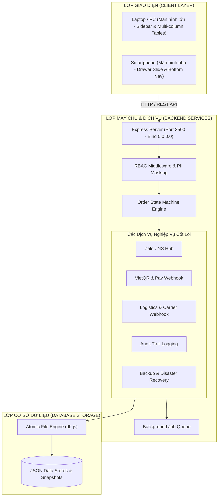
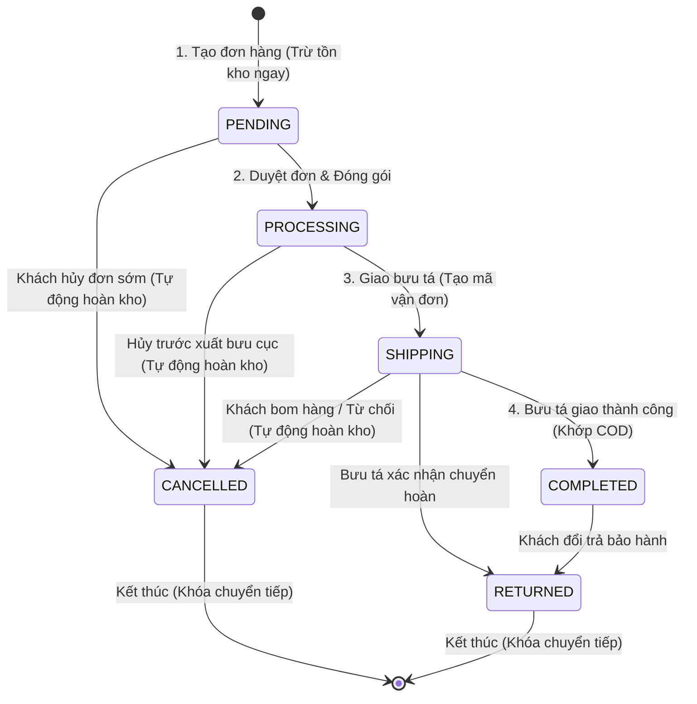
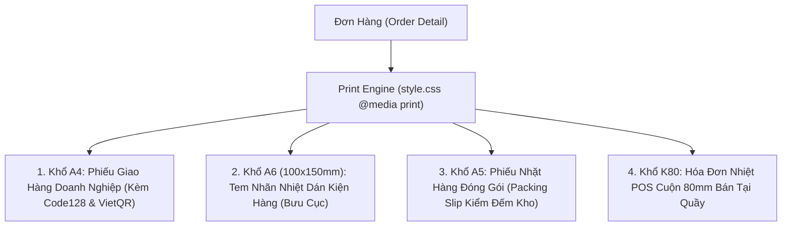

# TỔNG QUAN KIẾN TRÚC VÀ CẤU TRÚC HỆ THỐNG ZNS ORDER MASTER PRO (OMS)

> **Tài liệu Kỹ thuật & Nghiệp vụ Toàn diện**  
> Hệ thống Quản trị Đơn hàng Doanh nghiệp (Enterprise Order Management System)  
> Tích hợp Đa kênh, Zalo Notification Service (ZNS), VietQR Webhook, Logistics Webhook & Vận hành Đa nền tảng (PC/Mobile).

---

## 📑 MỤC LỤC
1. [Giới Thiệu Dự Án & Sứ Mệnh Nghiệp Vụ](#1-giới-thiệu-dự-án--sứ-mệnh-nghiệp-vụ)
2. [Cấu Trúc Thư Mục Toàn Bộ Dự Án (Folder Tree)](#2-cấu-trúc-thư-mục-toàn-bộ-dự-án-folder-tree)
3. [Kiến Trúc Tổng Thể & 5 Trụ Cột Vận Hành Thực Tế](#3-kiến-trúc-tổng-thể--5-trụ-cột-vận-hành-thực-tế)
4. [Cấu Trúc Giao Diện & Điều Hướng Đa Nền Tảng (Frontend & Responsive)](#4-cấu-trúc-giao-diện--điều-hướng-đa-nền-tảng-frontend--responsive)
5. [Mô Hình Dữ Liệu & Cấu Trúc Cơ Sở Dữ Liệu (Database Schemas)](#5-mô-hình-dữ-liệu--cấu-trúc-cơ-sở-dữ-liệu-database-schemas)
6. [Máy Trạng Thái Đơn Hàng Nghiêm Ngặt (Strict Order State Machine)](#6-máy-trạng-thái-đơn-hàng-nghiêm-ngặt-strict-order-state-machine)
7. [Phân Quyền Chi Tiết (RBAC) & Bảo Vệ Dữ Liệu Riêng Tư (PII Masking)](#7-phân-quyền-chi-tiết-rbac--bảo-vệ-dữ-liệu-riêng-tư-pii-masking)
8. [Tích Hợp Bên Thứ Ba & Bộ Giả Lập Webhook (Third-party Integrations)](#8-tích-hợp-bên-thứ-ba--bộ-giả-lập-webhook-third-party-integrations)
9. [Bộ Mẫu In Ấn Thương Mại Hóa (Commercial Print Templates)](#9-bộ-mẫu-in-ấn-thương-mại-hóa-commercial-print-templates)
10. [Danh Mục RESTful API Chi Tiết (API Specification)](#10-danh-mục-restful-api-chi-tiết-api-specification)
11. [Hướng Dẫn Khởi Động & Vận Hành Thực Tế (Deployment & Usage)](#11-hướng-dẫn-khởi-động--vận-hành-thực-tế-deployment--usage)

---

## 1. GIỚI THIỆU DỰ ÁN & SỨ MỆNH NGHIỆP VỤ

Trong một hệ thống thương mại thực tế, dữ liệu gắn liền trực tiếp với **dòng tiền, tồn kho hàng hóa, thông tin khách hàng và nghĩa vụ vận chuyển**. Bất kỳ sai sót nào trong tính toán đồng thời hoặc nhảy trạng thái bất thường đều có thể dẫn đến **thất thoát hàng triệu đồng, bán âm kho (overselling) hoặc rò rỉ thông tin khách hàng (PII leak)**.

**ZNS Order Master Pro (OMS Pro)** được thiết kế để giải quyết trọn vẹn các thách thức trên với:
* **Tính toán nguyên tử (ACID Transactions):** Đảm bảo tạo đơn, đổi trạng thái, trừ kho hoặc hoàn kho luôn toàn vẹn 100%.
* **Kiểm soát đồng thời lạc quan (Optimistic Concurrency Control):** Ngăn chặn 2 người cùng mua sản phẩm cuối cùng.
* **Tích hợp Zalo ZNS Hub:** Tự động gửi tin nhắn chăm sóc khách hàng tức thì qua ZNS mỗi khi đơn hàng thay đổi trạng thái.
* **Đối soát VietQR tự động:** Khách chuyển khoản quét mã VietQR tự động khớp tiền và chuyển trạng thái đơn trong 0.2 giây.
* **Đa nền tảng mượt mà:** Xem và thao tác liền mạch trên cả Laptop màn hình lớn lẫn Điện thoại di động (iPhone/Android).

---

## 2. CẤU TRÚC THƯ MỤC TOÀN BỘ DỰ ÁN (FOLDER TREE)

```text
Dự zns cá nhân/
├── CHAY-QUAN-LY-DON-HANG.bat      # Script khởi động Windows: kiểm tra môi trường, tự cài thư viện, mở web
├── CHAY-ZNS-OMS.bat               # Script dự phòng khởi động nhanh
├── .gitignore                     # Cấu hình bỏ qua node_modules và file tạm khi push Git
├── TONG-QUAN-KIEN-TRUC-HE-THONG-ZNS-OMS.md # File tài liệu tổng quan toàn bộ hệ thống
│
└── zns-oms/                       # MÃ NGUỒN CỐT LÕI HỆ THỐNG QUẢN LÝ ĐƠN HÀNG
    ├── package.json               # Cấu hình dự án Node.js & dependencies (Express, CORS)
    ├── package-lock.json          # Lock phiên bản thư viện
    ├── .gitignore                 # Bỏ qua thư mục node_modules/ nội bộ
    ├── README.md                  # Hướng dẫn nhanh dự án
    │
    ├── server.js                  # Entry point: Web server Express, định tuyến API, lắng nghe 0.0.0.0
    ├── db.js                      # Tầng truy xuất CSDL: Transaction, Khóa file, Optimistic Locking
    ├── rbac.js                    # Tầng phân quyền: Kiểm tra Role (Admin/Kho/CSKH) & Che giấu PII
    ├── stateMachine.js            # Tầng máy trạng thái: Ma trận trạng thái đơn, Tự động trừ/hoàn kho
    ├── znsService.js              # Tầng Zalo ZNS: Mẫu tin nhắn, Chế độ Sandbox/Live, Lịch sử gửi
    ├── logisticsService.js        # Tầng Vận chuyển: Giả lập bưu cục GHN/GHTK, webhook bưu tá
    ├── paymentService.js          # Tầng Thanh toán: Tạo VietQR động, Webhook ngân hàng tự động khớp đơn
    ├── auditService.js            # Tầng Kiểm toán: Ghi nhật ký mọi hành động sửa/xóa/xem PII
    ├── backupService.js           # Tầng Sao lưu: Snapshot toàn bộ dữ liệu định kỳ & Khôi phục (Restore)
    ├── queueService.js            # Tầng Hàng đợi: Xử lý tác vụ ngầm (Background Job Queue)
    │
    ├── data/                      # TẦNG CƠ SỞ DỮ LIỆU JSON ATOMIC
    │   ├── orders.json            # Bảng Đơn hàng (Thông tin chi tiết, line items, trạng thái, timeline)
    │   ├── products.json          # Bảng Sản phẩm & Tồn kho (SKU, giá nhập, giá bán, số lượng, version)
    │   ├── customers.json         # Bảng Khách hàng CRM (Lịch sử chi tiêu, phân hạng thành viên VIP)
    │   ├── categories.json        # Bảng Danh mục hàng hóa
    │   ├── settings.json          # Cấu hình cửa hàng, tài khoản ngân hàng VietQR, chế độ ZNS
    │   ├── audit_logs.json        # Nhật ký kiểm toán thao tác hệ thống (Audit Trail)
    │   ├── zns_logs.json          # Lịch sử thông báo Zalo ZNS đã gửi
    │   └── backups/               # Thư mục chứa các bản Snapshot sao lưu phục hồi thảm họa
    │
    └── public/                    # GIAO DIỆN NGƯỜI DÙNG (FRONTEND SINGLE PAGE APP)
        ├── index.html             # Cấu trúc giao diện HTML5, Tailwind CSS, 10 Views & Modals
        ├── css/
        │   └── style.css          # CSS tùy chỉnh, Mobile Drawer, Badge, Khung điện thoại, Khổ in A4/A6/K80
        └── js/
            └── app.js             # Logic điều hướng SPA, RBAC UI, Biểu đồ Chart.js, Render bảng, Xử lý chạm
```

---

## 3. KIẾN TRÚC TỔNG THỂ & 5 TRỤ CỘT VẬN HÀNH THỰC TẾ



### 🏛️ 5 Trụ Cột Vận Hành Cốt Lõi:
1. **Nghiệp vụ cốt lõi & Toàn vẹn dữ liệu (Business Logic & Integrity):**
   * Mọi thay đổi dữ liệu được bao bọc trong cơ chế Transaction ghi file an toàn (Write-to-temp then Atomic Rename).
   * Cơ chế **Optimistic Concurrency Control (OCC)** sử dụng trường `version` trong từng sản phẩm để chặn đứng xung đột khi nhiều người bán hàng cùng chốt đơn tại một thời điểm.
   * Máy trạng thái hữu hạn (Deterministic Finite State Machine) kiểm soát chặt chẽ từng bước chuyển đơn hàng.
2. **Bảo mật & Phân quyền (Security & Access Control):**
   * Phân quyền 3 cấp (Admin, Nhân viên Kho, Nhân viên CSKH/Bán hàng).
   * Ẩn thông tin khách hàng nhạy cảm (PII Masking) đối với bộ phận kho để chống rò rỉ dữ liệu khách.
   * Lưu vết mọi thao tác xem, sửa, xóa vào sổ nhật ký kiểm toán không thể chỉnh sửa.
3. **Tích hợp hệ sinh thái bên thứ ba (Ecosystem Integrations):**
   * Kết nối Zalo ZNS Hub gửi tin nhắn xác nhận, giao hàng và hoàn tất.
   * Tích hợp VietQR tạo mã thanh toán chuyển khoản động kèm Webhook đối soát tự động.
   * Tích hợp API đơn vị vận chuyển (GHN, GHTK, Viettel Post) kèm bộ giả lập Webhook bưu tá.
4. **In ấn & Dữ liệu thương mại (Printing & Reporting):**
   * Hỗ trợ 4 định dạng in thực tế: Phiếu giao A4, Tem nhãn dán kiện A6 (100x150mm), Phiếu nhặt hàng A5, Hóa đơn nhiệt K80 POS.
   * Xuất / Nhập danh mục và đơn hàng qua định dạng Excel/CSV.
5. **Hạ tầng & Khả năng phục hồi (Infrastructure & Reliability):**
   * Hàng đợi tác vụ ngầm (In-memory Message Queue) giải phóng hoàn toàn giao diện người dùng khỏi hiện tượng đóng băng khi thực hiện tác vụ nặng.
   * Tự động sao lưu Snapshot định kỳ với khả năng khôi phục tức thì khi có sự cố.

---

## 4. CẤU TRÚC GIAO DIỆN & ĐIỀU HƯỚNG ĐA NỀN TẢNG (FRONTEND & RESPONSIVE)

Giao diện được xây dựng dưới dạng **Single Page Application (SPA)** cực nhẹ, tải trang nhanh không phụ thuộc framework nặng, sử dụng Tailwind CSS:

```mermaid
graph LR
    subgraph Navigation["Điều Hướng SPA"]
        DesktopSide["Desktop: Left Fixed Sidebar (10 Menus)"]
        MobileDrawer["Mobile: Slide Drawer (Nút Hamburger ☰)"]
        MobileBottom["Mobile: Bottom Touch Bar (5 Phím Tắt)"]
    end

    subgraph Views["10 Phân Hệ Màn Hình Chính (Views)"]
        V1["1. Bàn làm việc (Dashboard KPI & Charts)"]
        V2["2. Quản lý Đơn hàng (Orders Grid & Filters)"]
        V3["3. Khách hàng CRM (Customers & Tiers)"]
        V4["4. Sản phẩm & Tồn kho (Products & Stock)"]
        V5["5. Vận chuyển & Webhook (Logistics Hub)"]
        V6["6. Đối soát & VietQR (Reconciliation)"]
        V7["7. Zalo ZNS Hub (Templates & Smartphone Preview)"]
        V8["8. Nhật ký Kiểm toán (Audit Trail)"]
        V9["9. Sao lưu & Khôi phục CSDL (Backups)"]
        V10["10. Giám sát & Hàng đợi (Queue & Metrics)"]
    end

    Navigation --> Views
```



### So Sánh Trải Nghiệm Laptop vs. Điện Thoại:

| Tiêu Chí | 💻 Trải Nghiệm Laptop / PC | 📱 Trải Nghiệm Điện Thoại Di Động |
| :--- | :--- | :--- |
| **Bố cục tổng quan** | 2 cột: Sidebar cố định 256px bên trái + Nội dung mở rộng bên phải. | 1 cột toàn màn hình, thanh tiêu đề gọn gàng với nút mở menu `☰`. |
| **Menu điều hướng** | Sidebar hiển thị liên tục 10 phân hệ nghiệp vụ. | **Drawer vuốt chạm trượt ngang** (tự động đóng khi chạm chọn màn hình). |
| **Thao tác nhanh** | Phím tắt, nút tạo đơn trên Header & Sidebar. | **Bottom Navigation Bar** chân màn hình với phím nổi tròn **"+" Tạo đơn nhanh**. |
| **Xem bảng đơn hàng** | Bảng dữ liệu đa cột rộng rãi, xem nhanh mã vận đơn, PII, trạng thái. | Hỗ trợ cuộn ngang mượt mà, chạm vào mã đơn là mở ngay Bottom Sheet chi tiết. |
| **In ấn hóa đơn** | Hỗ trợ xem trước và in trực tiếp ra máy in nhiệt hoặc máy in laser A4. | Hỗ trợ xem thông tin phiếu và quét mã vạch bằng camera điện thoại. |

---

## 5. MÔ HÌNH DỮ LIỆU & CẤU TRÚC CƠ SỞ DỮ LIỆU (DATABASE SCHEMAS)

Hệ thống lưu trữ dữ liệu tại thư mục `zns-oms/data/` dưới định dạng JSON có cấu trúc chặt chẽ:

### 1. Bảng Đơn Hàng (`orders.json`)
```json
{
  "id": "ord-1001",
  "code": "DH-2610-1001",
  "customerId": "cust-1",
  "customerName": "Nguyễn Văn An",
  "customerPhone": "0982345001",
  "customerAddress": "Tầng 5, Tòa nhà Bitexco, Q.1, TP.HCM",
  "items": [
    {
      "productId": "prod-1",
      "sku": "SP-TAI-NGHE-01",
      "name": "Tai nghe Bluetooth TrueWireless Pro Gen 3",
      "price": 490000,
      "quantity": 1,
      "total": 490000
    }
  ],
  "subtotal": 490000,
  "shippingFee": 30000,
  "discount": 0,
  "totalAmount": 520000,
  "orderStatus": "shipping",      // pending -> processing -> shipping -> completed / cancelled
  "paymentStatus": "paid",       // unpaid | paid | refunded
  "paymentMethod": "vietqr",     // cod | vietqr | banking
  "carrier": "GHN",              // GHN | GHTK | ViettelPost
  "trackingCode": "GHN-VN-884920",
  "sendZns": true,
  "version": 2,                  // Optimistic Lock Version
  "timeline": [
    { "status": "pending", "updatedAt": "2026-10-13T08:00:00Z", "note": "Đơn hàng mới tạo" },
    { "status": "shipping", "updatedAt": "2026-10-13T09:15:00Z", "note": "Bưu tá đã nhận hàng" }
  ],
  "createdAt": "2026-10-13T08:00:00.000Z",
  "updatedAt": "2026-10-13T09:15:00.000Z"
}
```

### 2. Bảng Sản Phẩm & Tồn Kho (`products.json`)
```json
{
  "id": "prod-1",
  "sku": "SP-TAI-NGHE-01",
  "barcode": "893850123001",
  "name": "Tai nghe Bluetooth TrueWireless Pro Gen 3",
  "categoryId": "cat-1",
  "categoryName": "Đồ Điện Tử & Công Nghệ",
  "costPrice": 280000,           // Ẩn với nhân viên kho
  "salePrice": 490000,
  "stock": 45,
  "minStock": 10,
  "unit": "Chiếc",
  "status": "active",
  "version": 1,                  // Ngăn ngừa bán âm kho (Overselling)
  "createdAt": "2026-10-01T08:00:00.000Z"
}
```

### 3. Bảng Khách Hàng CRM (`customers.json`)
```json
{
  "id": "cust-1",
  "name": "Nguyễn Văn An",
  "phone": "0982345001",
  "email": "nguyenvanan@gmail.com",
  "address": "Tầng 5, Tòa nhà Bitexco, Q.1, TP.HCM",
  "totalSpent": 12850000,
  "totalOrders": 14,
  "tier": "gold",                // standard | silver | gold | platinum | diamond
  "createdAt": "2026-09-01T10:00:00.000Z"
}
```

### 4. Bảng Cấu Hình Cửa Hàng & VietQR (`settings.json`)
```json
{
  "storeName": "ZNS Tech Store - Phụ Kiện Chính Hãng",
  "storePhone": "0901.888.999",
  "storeAddress": "128 Nguyễn Trãi, Phường Bến Thành, Quận 1, TP.HCM",
  "bankName": "MB Bank (Ngân hàng Quân Đội)",
  "bankBin": "970422",
  "bankAccount": "0901888999",
  "bankOwner": "NGUYEN QUAN TRI",
  "znsMode": "sandbox",
  "autoSendZns": true
}
```

---

## 6. MÁY TRẠNG THÁI ĐƠN HÀNG NGHIÊM NGẶT (STRICT ORDER STATE MACHINE)

Hệ thống tuân thủ mô hình máy trạng thái hữu hạn để loại trừ hoàn toàn các thao tác nhảy cóc hoặc đảo ngược trạng thái vô lý:



### Ma Trận Chuyển Đổi Trạng Thái Hợp Lệ:
* `pending` $\rightarrow$ `['processing', 'cancelled']`
* `processing` $\rightarrow$ `['shipping', 'cancelled']`
* `shipping` $\rightarrow$ `['completed', 'cancelled', 'returned']`
* `completed` $\rightarrow$ `['returned']`
* `cancelled` $\rightarrow$ `[]` *(Terminal State - Khóa vĩnh viễn)*
* `returned` $\rightarrow$ `[]` *(Terminal State - Khóa vĩnh viễn)*

> **Quy tắc bảo vệ kho:** Bất cứ khi nào đơn chuyển sang `cancelled` hoặc `returned`, hệ thống tự động cộng hoàn trả số lượng vào cột tồn kho của sản phẩm trong transaction nguyên tử.

---

## 7. PHÂN QUYỀN CHI TIẾT (RBAC) & BẢO VỆ DỮ LIỆU RIÊNG TƯ (PII MASKING)

### Ma Trận Phân Quyền 3 Cấp:

| Nghiệp Vụ / Quyền Hạn | 👑 Admin (Chủ Shop) | 📦 Kho (Warehouse) | 💼 CSKH / Bán Hàng (Sales) |
| :--- | :---: | :---: | :---: |
| **Xem Doanh thu & Lãi lỗ** | ✅ Toàn quyền | ❌ **Ẩn hoàn toàn** | ✅ Xem doanh số bán lẻ |
| **Xem Giá vốn (Cost Price)** | ✅ Toàn quyền | ❌ **Ẩn hoàn toàn** | ❌ Ẩn giá nhập |
| **Tạo Đơn Hàng Mới** | ✅ Có quyền | ❌ Bị chặn | ✅ Toàn quyền tạo đơn |
| **Xóa Vĩnh Viễn Đơn Hàng** | ✅ Có quyền | ❌ Bị chặn | ❌ Bị chặn |
| **Hiển thị PII Khách Hàng** | ✅ Đầy đủ | 🔒 **Che sao (`0982***001`)** | ✅ Đầy đủ |
| **Mở khóa PII (Unmask)** | ✅ Tự do | ⚠️ **Cần nhập lý do & ghi Audit** | ✅ Tự do |
| **In Tem Nhãn A6 & Nhặt Kho** | ✅ Có quyền | ✅ **Toàn quyền vận hành** | ❌ Không phụ trách |
| **Sao Lưu & Restore CSDL** | ✅ Toàn quyền | ❌ Bị chặn | ❌ Bị chặn |

---

## 8. TÍCH HỢP BÊN THỨ BA & BỘ GIẢ LẬP WEBHOOK (THIRD-PARTY INTEGRATIONS)

### 1. Zalo Notification Service (ZNS) Hub:
* Khi đơn tạo mới $\rightarrow$ Gửi template ZNS: *“Đơn hàng [Mã đơn] đã được tiếp nhận”*.
* Khi giao bưu tá $\rightarrow$ Gửi template ZNS: *“Đơn hàng đang giao bởi [Bưu cục], mã vận đơn [Mã]”*.
* Khi giao thành công $\rightarrow$ Gửi template ZNS: *“Đơn hàng đã giao thành công. Cảm ơn quý khách!”*.
* Cung cấp **Smartphone ZNS Mockup** trực quan hiển thị bóng chat tin nhắn Zalo sống động ngay trên web.

### 2. VietQR & Webhook Đối Soát Chuyển Khoản Tự Động:
* Tự động sinh mã VietQR theo chuẩn Napas 247: `https://img.vietqr.io/image/{bankBin}-{bankAccount}-compact2.png?amount={total}&addInfo={code}`.
* **Webhook Ngân hàng (`POST /api/webhooks/payment`):** Nhận biến động số dư từ Vietcombank/MBBank/Techcombank $\rightarrow$ Tự động trích xuất mã đơn `DH-...` $\rightarrow$ Chuyển trạng thái sang `paid` trong 0.2s.
* Tích hợp **Trình Giả Lập Chuyển Khoản Ngân Hàng** để kiểm thử đối soát 1 chạm.

### 3. Logistics APIs & Webhook Bưu Tá:
* Hỗ trợ gán mã vận đơn của các bưu cục hàng đầu (Giao Hàng Nhanh, Giao Hàng Tiết Kiệm, Viettel Post).
* **Webhook Vận chuyển (`POST /api/webhooks/shipping`):** Nhận tín hiệu quét mã của shipper $\rightarrow$ Tự động chuyển đơn sang `shipping` hoặc `completed`.
* Tích hợp **Bộ Giả Lập Shipper Quét Hàng** với 4 kịch bản giao nhận chuẩn.

---

## 9. BỘ MẪU IN ẤN THƯƠNG MẠI HÓA (COMMERCIAL PRINT TEMPLATES)

Hệ thống hỗ trợ in ấn chuyên nghiệp chuẩn quốc tế và tương thích mọi dòng máy in:



---

## 10. DANH MỤC RESTFUL API CHI TIẾT (API SPECIFICATION)

| Nhóm API | Method | Endpoint | Mô Tả Chức Năng |
| :--- | :--- | :--- | :--- |
| **Hệ thống & Mạng** | `GET` | `/api/system/network-info` | Lấy địa chỉ IP nội bộ (`192.168.1.34`), cổng 3500 và mã QR truy cập điện thoại |
| **Đơn hàng** | `GET` | `/api/orders` | Lấy danh sách toàn bộ đơn hàng (kèm lọc trạng thái & tìm kiếm) |
| | `GET` | `/api/orders/:id` | Xem chi tiết 1 đơn hàng (áp dụng PII masking theo vai trò) |
| | `POST` | `/api/orders` | Tạo đơn hàng mới trong Transaction nguyên tử (trừ kho ngay) |
| | `PATCH` | `/api/orders/:id/status` | Chuyển trạng thái đơn hàng theo máy trạng thái nghiêm ngặt |
| | `POST` | `/api/orders/:id/unmask-pii` | Mở khóa xem đầy đủ SĐT/địa chỉ khách (ghi Audit Log) |
| | `DELETE`| `/api/orders/:id` | Xóa đơn hàng vĩnh viễn (Chỉ Admin) |
| **Sản phẩm & Kho** | `GET` | `/api/products` | Lấy danh mục sản phẩm (ẩn giá vốn nếu là nhân viên kho) |
| | `POST` | `/api/products` | Tạo sản phẩm mới |
| | `PUT` | `/api/products/:id` | Cập nhật sản phẩm & tồn kho với Optimistic Lock version |
| | `POST` | `/api/products/import-csv` | Nhập danh mục sản phẩm hàng loạt bằng file CSV/Excel |
| **Khách hàng** | `GET` | `/api/customers` | Danh sách khách hàng CRM và lịch sử tích lũy chi tiêu |
| | `POST` | `/api/customers` | Thêm mới hồ sơ khách hàng |
| **Webhooks** | `POST` | `/api/webhooks/shipping` | Webhook nhận trạng thái bưu tá từ GHN, GHTK, Viettel Post |
| | `POST` | `/api/webhooks/payment` | Webhook nhận biến động số dư ngân hàng VietQR khớp tiền đơn |
| **Kiểm toán & Sao lưu**| `GET` | `/api/audit/logs` | Lấy toàn bộ nhật ký thao tác kiểm toán của nhân viên |
| | `GET` | `/api/backups` | Lấy danh sách các bản snapshot sao lưu CSDL |
| | `POST` | `/api/backups/create` | Tạo ngay 1 bản sao lưu dự phòng CSDL mới |
| | `POST` | `/api/backups/restore` | Khôi phục hệ thống về một mốc sao lưu trong quá khứ |
| **Báo cáo & Cài đặt**| `GET` | `/api/reports/dashboard` | Thống kê doanh thu, số đơn, hàng bán chạy, xu hướng 7 ngày |
| | `GET` | `/api/settings` | Lấy cấu hình cửa hàng, tài khoản ngân hàng VietQR |
| | `PUT` | `/api/settings` | Cập nhật cấu hình cửa hàng |

---

## 11. HƯỚNG DẪN KHỞI ĐỘNG & VẬN HÀNH THỰC TẾ (DEPLOYMENT & USAGE)

### 1. Khởi động 1 chạm trên Windows:
* Nhấp đúp chuột vào file **[`CHAY-QUAN-LY-DON-HANG.bat`](file:///c:/Users/khanh/OneDrive/D%E1%BB%B1%20zns%20c%C3%A1%20nh%C3%A2n/CHAY-QUAN-LY-DON-HANG.bat)**.
* Script sẽ tự động:
  1. Kiểm tra môi trường Node.js.
  2. Tự động chạy `npm install` nếu chưa có thư viện `node_modules`.
  3. Kiểm tra cổng 3500 để tránh xung đột tiến trình.
  4. Hẹn giờ 3 giây khởi động trình duyệt mở sẵn hệ thống.
  5. In ra màn hình bảng hướng dẫn kèm đường dẫn cho cả Laptop và Điện thoại.

### 2. Cách truy cập:
* **Trên Laptop / Máy tính:** Mở trình duyệt truy cập: `http://localhost:3500`
* **Trên Điện thoại di động (iPhone / Android):** 
  * Kết nối cùng mạng Wi-Fi với Laptop.
  * Mở trình duyệt (Safari / Chrome) gõ: `http://192.168.1.34:3500`
  * Giao diện điện thoại sẽ tự động kích hoạt chế độ Drawer trượt ngang và thanh Bottom Navigation Bar cảm ứng tiện lợi.

### 3. Đồng bộ và lưu trữ với GitHub:
* Repository chính thức: [https://github.com/nguyenkhanh3122005/quanlybanhang](https://github.com/nguyenkhanh3122005/quanlybanhang)
* Khi có cập nhật mới, chỉ cần chạy lệnh:
  ```bash
  git add .
  git commit -m "update: noi dung cap nhat"
  git push origin main
  ```

---

## 12. TOÀN BỘ MÃ NGUỒN CHẠY WEB (COMPLETE EXECUTABLE SOURCE CODE)

Phần này đính kèm toàn bộ mã nguồn quan trọng nhất để hệ thống có thể vận hành độc lập. Bạn có thể tham khảo trực tiếp hoặc sao chép khi triển khai lên máy chủ mới:

### 12.1. File Chạy Độc Lập Một Chạm (`ZNS-OMS-Standalone.js`)
File độc lập giúp khởi động toàn bộ Web Server chỉ bằng 1 câu lệnh Node.js mà không cần thiết lập phức tạp:

```javascript
/**
 * ZNS ORDER MASTER PRO - STANDALONE ALL-IN-ONE RUNNER
 * Chạy trực tiếp: node ZNS-OMS-Standalone.js
 */
const path = require('path');
const fs = require('fs');
const os = require('os');

const OMS_DIR = path.join(__dirname, 'zns-oms');

if (!fs.existsSync(OMS_DIR) || !fs.existsSync(path.join(OMS_DIR, 'server.js'))) {
  console.error('[LỖI] Không tìm thấy thư mục zns-oms hoặc file server.js!');
  process.exit(1);
}

const omsNodeModules = path.join(OMS_DIR, 'node_modules');
if (fs.existsSync(omsNodeModules)) {
  module.paths.unshift(omsNodeModules);
}

function getLocalIP() {
  const interfaces = os.networkInterfaces();
  const candidates = [];
  for (const name of Object.keys(interfaces)) {
    for (const iface of interfaces[name]) {
      if (iface.family === 'IPv4' && !iface.internal) {
        if (!name.toLowerCase().includes('virtual') &&
            !name.toLowerCase().includes('vbox') &&
            !name.toLowerCase().includes('vmware') &&
            !name.toLowerCase().includes('loopback')) {
          candidates.push({ name, address: iface.address });
        }
      }
    }
  }
  const wifi = candidates.find(c => c.address.startsWith('192.168.1.') || c.name.toLowerCase().includes('wi-fi') || c.name.toLowerCase().includes('wlan'));
  if (wifi) return wifi.address;
  return candidates[0] ? candidates[0].address : '127.0.0.1';
}

console.log('====================================================================');
console.log('   ZNS ORDER MASTER PRO - NỀN TẢNG QUẢN LÝ ĐƠN HÀNG DOANH NGHIỆP    ');
console.log('====================================================================');
console.log('Đang khởi chạy hệ thống Web Server...');

process.chdir(OMS_DIR);
require(path.join(OMS_DIR, 'server.js'));

const localIP = getLocalIP();
const PORT = process.env.PORT || 3500;

setTimeout(() => {
  console.log('\n====================================================================');
  console.log('✅ HỆ THỐNG ĐÃ SẴN SÀNG HOẠT ĐỘNG TRÊN CẢ LAPTOP VÀ ĐIỆN THOẠI:');
  console.log('--------------------------------------------------------------------');
  console.log(`💻 Xem trên Laptop / PC:     http://localhost:${PORT}`);
  console.log(`📱 Xem trên Điện thoại (Wi-Fi): http://${localIP}:${PORT}`);
  console.log('====================================================================');
}, 500);
```

---

### 12.2. Script Khởi Động Tự Động Trên Windows (`CHAY-QUAN-LY-DON-HANG.bat`)

```batch
@echo off
title ZNS ORDER MASTER PRO - He Thong Quan Ly Don Hang va Zalo ZNS
chcp 65001 >nul
cls

echo ====================================================================
echo      ZNS ORDER MASTER PRO - HE THONG QUAN LY DON HANG VA ZNS
echo      Nen Tang Quan Ly Don - Ton Kho - Khach Hang - Zalo ZNS
echo ====================================================================
echo.

:: [1] Kiem tra moi truong Node.js
echo [1/5] Kiem tra moi truong Node.js...
node -v >nul 2>&1
if %errorlevel% neq 0 (
    echo.
    echo [LOI] Khong tim thay Node.js tren he thong!
    echo Vui long cai dat Node.js tai https://nodejs.org/ truoc khi su dung.
    pause
    exit /b 1
)

:: [2] Kiem tra thu muc du an va file server.js
echo [2/5] Kiem tra tep ma nguon server.js...
if not exist "%~dp0zns-oms\server.js" (
    echo [LOI] Khong tim thay file "server.js" trong thu muc "zns-oms"!
    pause
    exit /b 1
)

cd /d "%~dp0zns-oms"

:: [3] Kiem tra goi thu vien node_modules
echo [3/5] Kiem tra goi thu vien node_modules...
if not exist "node_modules" (
    echo [THONG BAO] Phat hien chua cai dat thu vien, dang tu dong chay "npm install"...
    call npm install
    if %errorlevel% neq 0 (
        echo [LOI] Cai dat thu vien that bai. Vui long kiem tra lai ket noi mang.
        pause
        exit /b 1
    )
    echo [OK] Da cai dat xong thu vien phu thuoc!
)

:: [4] Kiem tra xung dot cong mang (Port 3500)
echo [4/5] Kiem tra trang thai cong 3500...
netstat -ano | findstr /r /c:":3500 .*LISTENING" >nul 2>&1
if %errorlevel% equ 0 (
    echo.
    echo ====================================================================
    echo [THONG BAO] Cong 3500 da dang hoat dong - Web Server da chay san!
    echo.
    echo  - Xem tren Laptop:     http://localhost:3500
    echo  - Xem tren Dien thoai:  http://192.168.1.34:3500
    echo ====================================================================
    start http://localhost:3500
    pause
    exit /b 0
)

:: [5] Hen gio 3 giay mo trinh duyet trong nen
echo [5/5] Dang chuan bi khoi dong trinh duyet tai http://localhost:3500...
start /b cmd /c "timeout /t 3 /nobreak >nul & start http://localhost:3500"

:: [6] Khoi dong Server Node.js
echo.
echo ====================================================================
echo  DANG KHOI DONG WEB SERVER TAI CONG 3500...
echo  - Laptop / May tinh:  http://localhost:3500
echo  - Dien thoai (Wi-Fi): http://192.168.1.34:3500
echo.
echo  (Nhan to hop phim Ctrl + C de dong he thong khi ket thuc ca lam viec)
echo ====================================================================
echo.
node server.js
```

---

### 12.3. Máy Trạng Thái Đơn Hàng Nghiêm Ngặt (`zns-oms/stateMachine.js`)

```javascript
/**
 * STRICT ORDER STATE MACHINE
 * Ma trận trạng thái chuyển tiếp hợp lệ và bù hoàn kho tự động
 */
const db = require('./db');

const ORDER_STATES = {
  PENDING: 'pending',       // Chờ duyệt
  PROCESSING: 'processing', // Đang đóng gói / chuẩn bị hàng
  SHIPPING: 'shipping',     // Đang giao hàng (đã giao bưu tá)
  COMPLETED: 'completed',   // Đã giao thành công
  CANCELLED: 'cancelled',   // Đã hủy đơn
  RETURNED: 'returned'      // Chuyển hoàn / Trả hàng
};

const VALID_TRANSITIONS = {
  [ORDER_STATES.PENDING]: [ORDER_STATES.PROCESSING, ORDER_STATES.CANCELLED],
  [ORDER_STATES.PROCESSING]: [ORDER_STATES.SHIPPING, ORDER_STATES.CANCELLED],
  [ORDER_STATES.SHIPPING]: [ORDER_STATES.COMPLETED, ORDER_STATES.CANCELLED, ORDER_STATES.RETURNED],
  [ORDER_STATES.COMPLETED]: [ORDER_STATES.RETURNED],
  [ORDER_STATES.CANCELLED]: [],
  [ORDER_STATES.RETURNED]: []
};

class StateMachineError extends Error {
  constructor(message, code = 'INVALID_TRANSITION') {
    super(message);
    this.name = 'StateMachineError';
    this.code = code;
  }
}

class OrderStateMachine {
  static getValidNextStates(currentState) {
    return VALID_TRANSITIONS[currentState] || [];
  }

  static canTransition(fromState, toState) {
    const allowed = VALID_TRANSITIONS[fromState] || [];
    return allowed.includes(toState);
  }

  static async transition(orderId, nextState, metadata = {}) {
    return await db.runTransaction(async () => {
      const order = db.getOrderById(orderId);
      if (!order) throw new StateMachineError(`Không tìm thấy đơn hàng ID: ${orderId}`);

      const currentState = order.orderStatus;
      if (currentState === nextState) return order;

      if (!OrderStateMachine.canTransition(currentState, nextState)) {
        throw new StateMachineError(
          `Không thể chuyển trạng thái từ "${currentState}" sang "${nextState}". Bước chuyển không hợp lệ!`,
          'INVALID_STATE_TRANSITION'
        );
      }

      // Tự động hoàn lại tồn kho nếu hủy đơn hoặc chuyển hoàn
      if ((nextState === ORDER_STATES.CANCELLED || nextState === ORDER_STATES.RETURNED) &&
          currentState !== ORDER_STATES.CANCELLED && currentState !== ORDER_STATES.RETURNED) {
        for (const item of (order.items || [])) {
          const prod = db.getProductById(item.productId);
          if (prod) {
            prod.stock += (item.quantity || 1);
            prod.version = (prod.version || 0) + 1;
            db.updateProduct(prod.id, prod);
          }
        }
      }

      order.orderStatus = nextState;
      order.version = (order.version || 0) + 1;
      order.updatedAt = new Date().toISOString();
      order.timeline = order.timeline || [];
      order.timeline.push({
        status: nextState,
        updatedAt: new Date().toISOString(),
        actor: metadata.actor || 'System',
        note: metadata.note || `Chuyển trạng thái sang ${nextState}`
      });

      db.updateOrder(order.id, order);
      return order;
    });
  }
}

module.exports = { ORDER_STATES, OrderStateMachine, StateMachineError };
```

---

### 12.4. Phân Quyền Chi Tiết & Che Giấu Dữ Liệu PII (`zns-oms/rbac.js`)

```javascript
/**
 * ROLE-BASED ACCESS CONTROL (RBAC) & PII MASKING
 */
const ROLES = {
  ADMIN: 'admin',
  WAREHOUSE: 'warehouse',
  SALES: 'sales'
};

const PERMISSIONS = {
  [ROLES.ADMIN]: {
    viewRevenue: true,
    viewCostPrice: true,
    viewPII: true,
    createOrder: true,
    editOrder: true,
    deleteOrder: true,
    manageBackups: true
  },
  [ROLES.WAREHOUSE]: {
    viewRevenue: false,     // Ẩn doanh thu
    viewCostPrice: false,   // Ẩn giá vốn
    viewPII: false,         // Che số điện thoại & địa chỉ
    createOrder: false,
    editOrder: true,        // Được đổi trạng thái giao nhận
    deleteOrder: false,
    manageBackups: false
  },
  [ROLES.SALES]: {
    viewRevenue: true,
    viewCostPrice: false,
    viewPII: true,
    createOrder: true,
    editOrder: true,
    deleteOrder: false,
    manageBackups: false
  }
};

function maskCustomerPII(phone, address) {
  let maskedPhone = phone || '';
  if (maskedPhone.length >= 8) {
    maskedPhone = maskedPhone.slice(0, 4) + '***' + maskedPhone.slice(-3);
  }
  let maskedAddress = address || '';
  if (maskedAddress.length > 12) {
    const parts = maskedAddress.split(',');
    maskedAddress = parts.length > 1 ? `***, ${parts[parts.length - 1].trim()}` : maskedAddress.slice(0, 6) + '... (Đã ẩn)';
  }
  return { phone: maskedPhone, address: maskedAddress };
}

module.exports = { ROLES, PERMISSIONS, maskCustomerPII };
```

---

### 12.5. Tầng Truy Xuất CSDL & Giao Dịch Nguyên Tử (`zns-oms/db.js`)

```javascript
/**
 * ATOMIC FILE-BASED DATABASE ENGINE
 * Đảm bảo ACID Transactions qua Atomic Temp-File Rename & Locking
 */
const fs = require('fs');
const path = require('path');

const DATA_DIR = path.join(__dirname, 'data');
if (!fs.existsSync(DATA_DIR)) fs.mkdirSync(DATA_DIR, { recursive: true });

function readJSON(filePath, defaultVal = []) {
  try {
    if (!fs.existsSync(filePath)) {
      fs.writeFileSync(filePath, JSON.stringify(defaultVal, null, 2), 'utf8');
      return defaultVal;
    }
    const raw = fs.readFileSync(filePath, 'utf8');
    return JSON.parse(raw);
  } catch (err) {
    return defaultVal;
  }
}

function writeJSONAtomic(filePath, data) {
  const tmpPath = `${filePath}.${Date.now()}.tmp`;
  fs.writeFileSync(tmpPath, JSON.stringify(data, null, 2), 'utf8');
  fs.renameSync(tmpPath, filePath);
}

let isLocked = false;
async function runTransaction(actionFn) {
  while (isLocked) {
    await new Promise(r => setTimeout(r, 15));
  }
  isLocked = true;
  try {
    const result = await actionFn();
    return result;
  } catch (error) {
    throw error;
  } finally {
    isLocked = false;
  }
}

module.exports = { readJSON, writeJSONAtomic, runTransaction };
```

---
*Tài liệu được cập nhật đầy đủ mã nguồn và quản trị tập trung bởi Hệ thống Trợ lý Lập trình Viên AI - Google DeepMind Antigravity.*

